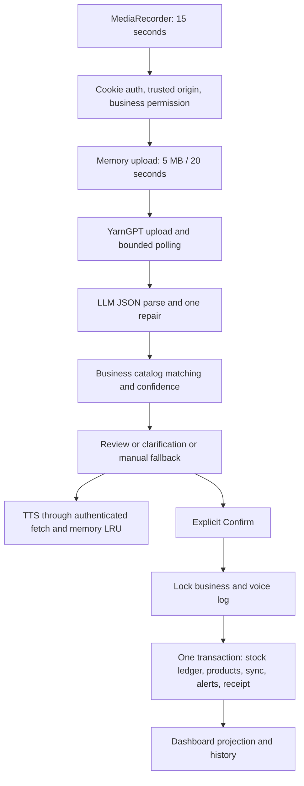

# Voice inventory (Phase 2)

The [live multilingual extension](voice-live.md) adds PCM streaming, partial
transcripts, spoken confirmation, indexed candidate search, queries, expiry and
approved aliases. Read that report for current configuration and limitations;
the upload-focused description below documents the original fallback workflow.

Authenticated shops now record audio, review a proposed stock change, and explicitly
confirm it. The existing Express/TypeScript, Prisma/PostgreSQL, cookie auth,
React/Vite JSX, CSS and Node test runner remain in use. The old guest sample chat
is a separate prototype. No provider credential is sent to the browser.



## Keyless local demo

Install Node 22.12+ (22.x) or Node 24.x. From the repository root:

```powershell
cd server
npm ci
npm --prefix ../web ci
npm run voice:demo
```

Open the printed localhost URL and sign in with the printed phone/password.
Open **Talk to Vendora**. This command builds the frontend, generates signing keys,
starts/migrates a disposable embedded PostgreSQL database, and seeds nine Nigerian
provisions products. It requires no `.env`, PostgreSQL server, Redis or paid keys.
Only localhost is bound. Ctrl+C stops the demo database; each run gets a fresh shop.
The mock limiter is deliberately disabled in this local test harness; the normal
application uses Redis. First `npm ci` requires network access for dependencies.

Try the typed transcript `I sold 2 bags of rice`: stock remains 6 until Confirm,
then becomes 4 and a low-stock alert appears. Try `I sold 2 bags beans` for the
Brown beans / White beans chips. `gibberish` and silence offer manual entry.
Microphone recordings in mock mode use the default canned rice transcript; mock
TTS is a bundled silent MP3. Typed inputs exercise alternate fixtures.

## Existing application / real providers

Copy `server/.env.example` to `server/.env` and retain the existing database,
Redis, auth and cookie configuration documented in `backend-auth.md`. Put voice
keys **only in that server file**:

```dotenv
VOICE_MOCK_MODE=false
YARNGPT_API_KEY=<your key>
YARNGPT_BASE_URL=https://api.yarngpt.ai
YARNGPT_TTS_VOICE=
LLM_PROVIDER=anthropic
LLM_API_KEY=<your key>
LLM_MODEL=<model enabled in your account>
LLM_BASE_URL=
VOICE_ASR_TIMEOUT_MS=15000
VOICE_LLM_TIMEOUT_MS=10000
```

Choose `openai` for an OpenAI-compatible chat endpoint. `LLM_BASE_URL` is its full
API root (typically ending in `/v1`); the Anthropic root also includes `/v1`.
Model ids have no default. Missing live keys/model stop startup with a field-name
error. Set `VOICE_MOCK_MODE=true` for the normal app to skip all external calls.
Tests explicitly use mock mode, regardless of real credentials in `.env`.

```powershell
cd server
npm run db:deploy
# With the migration/admin credential, rerun prisma/runtime-grants.sql.
npm run generate
npm run voice:seed -- --business <business-uuid> --user <owner-user-uuid>
npm run dev
# Separate terminal in web/: npm run dev
```

The chosen owner must have `sales:write`, and the shop must already be RELATIONAL
(existing migration flow in `inventory-backfill.md`). Seeding is idempotent and
never resets stock. Rice starts at 6 bags with a threshold of 5. Existing Phase 1
demo data/login rules remain intact; `voice:seed` extends seeding via its own command.

## API

Every endpoint requires session cookies, an authorized `X-Business-ID`, and
`sales:write`. Mutations require a trusted Origin; JSON is required except the
single multipart upload route. Keep the same cookie session/refresh client.
`apiRequest` supports FormData and blob responses with credentials and business
headers, rather than putting a credential in an audio URL.

| Method/path | Input | Result |
| --- | --- | --- |
| GET `/api/voice/config` | none | mock/typed switch, no secrets |
| POST `/api/voice/commands` | multipart `audio` (one file); development/mock also `{transcript}` | proposal, never stock writes |
| GET `/api/voice/commands/:id/readback` | none | `audio/mpeg`; 204 on TTS failure |
| POST `/api/voice/commands/:id/confirm` | `{}` or edits below | confirmed products, movements and alerts |
| POST `/api/voice/commands/:id/reject` | `{}` | rejected proposal, no movement |
| GET `/api/voice/commands?limit=20&cursor=UUID` | limit 1–100, last returned cursor | commands and `next_cursor` |
| POST `/api/voice/manual` | `{action,items:[{product_id,quantity}]}` | pending manual review card |

Example upload (PowerShell uses `curl.exe`):

```text
curl -X POST http://localhost:8080/api/voice/commands \
  -H "Origin: http://localhost:5173" -H "X-Business-ID: <uuid>" \
  -b cookies.txt -F "audio=@clip.webm;type=audio/webm"
```

For mock uploads, `X-Mock-Transcript: add 10 crates of eggs` selects the canned
transcript. That header is ignored outside mock mode. JSON example:

```json
{"transcript":"I sold 2 bags of rice"}
```

Response example (UUIDs abbreviated for readability):

```json
{
  "voice_log_id":"uuid", "status":"pending", "transcript":"I sold 2 bags of rice",
  "parsed":{"action":"sale","items":[{"spoken_name":"rice","quantity":2,"unit":"bag","product_id":"uuid"}],"needs_clarification":false,"clarification_question":null},
  "candidates":[[{"product_id":"uuid","name":"Rice","unit":"bag","current_qty":"6","score":1}]],
  "confidence":1,"readback_text":"Sold 2 bags of Rice. Is that correct?"
}
```

Single-item edits: `{product_id, quantity, action, allow_negative}`. Multi-item
edits: `{action, items:[{product_id,quantity},...], allow_negative:false}`; review
every original line. Sale/restock quantities are positive integers; adjustments
are signed nonzero integers. Spoilage removes stock. Absolute “correct to” counts
require manual stock-count review, never an inferred delta. A unit mismatch must
be explicitly edited/reviewed. Single-item clarification chips labelled **Confirm
Product** explicitly confirm that selection when its unit agrees; unit-mismatch
and multi-item chips select each line
and the main Confirm posts all lines together.

`409 INSUFFICIENT_STOCK` includes available quantity. The card then offers an
explicit checkbox for a physical change that makes stock negative. Retry with
`allow_negative:true` only after that choice. Double confirmation returns the
saved response even if the response to the first request was lost. Rejected,
failed and processing commands cannot be confirmed.

## Matching and operational behavior

`server/src/config/voice.ts` holds weights, thresholds, timeouts and prompt
examples. Confidence weights are match .50, top/second margin .20, recognized
action .15, and valid integer quantity .15. Pending starts at .85; clarification
at .60. Aliases/names are normalized and compared using deterministic
Levenshtein/Jaccard scores. Low match or unknown action fails to manual entry.
The existing trigram extension/index stays unchanged; this pipeline needs no new
database extension. These scores are matching heuristics, not calibrated ASR
probabilities.

Only `Confirm` writes stock. It locks the business first (the existing inventory
lock order), then the voice log, rechecks membership and catalog ownership, posts
every item through the ledger, publishes sync changes, and saves alerts/receipt in
one transaction. Replays return that receipt. First item `reference_id` equals the
voice UUID; later items use `UUID:item-index`. The requested unique partial voice
reference index is retained, while the locked command receipt makes the entire
multi-item command idempotent.

TTS resolves the default voice at startup and caches it; unknown catalog shapes
fall back to an omitted voice. Logs record the raw response's **shape** (field
names), not arbitrary strings, to preserve secret redaction. Read-back cache is
an in-memory LRU bounded by entries and bytes, keyed by text hash. Concurrent
requests for the same text share one generation. Browser autoplay rejection or
TTS failure falls back to device speech, then readable text. Neither changes stock.

Stage logs use allowlisted `voice_log_id`, `trace_id`, error codes and latency;
provider messages/keys and raw audio are never logged. Raw uploaded audio exists
only in request memory and is not persisted. JSON transcripts and derived data
are retained in `voice_logs` for history. Processing interrupted by a process
crash remains in history and can be safely re-recorded; it cannot change stock.

## Evaluation and tests

```powershell
cd server
npm run test:voice
npm test
npm run test:integration:isolated
npm run typecheck
npm run lint
npm run build
npm --prefix ../web test
npm --prefix ../web run build
npx playwright test test/browser/voice.spec.ts
npm run voice:eval
# Paid, explicit opt-in; estimated initial call count is printed first:
npm run voice:eval -- --live
npm run voice:eval -- --live --transcribe "./clips/*.webm"
```

`eval/phrases.json` contains 25 extensible examples with expected action, item,
quantity and optional decision status. Evaluation reports per-command action,
item/quantity-list and end-to-end accuracy. Clip mode reports p50/p95 latency and
word accuracy using sibling `.txt` ground-truth files (`clip.webm` + `clip.txt`);
clips without ground truth are marked unscored. Only `--live` uses paid APIs.
The mock evaluator measures fixture coverage, not real language-model quality.

## Known limitations and assumptions

- No separate Project Document with sections 4.1/6 was included in the attachment;
  the pasted task and current Phase 1 schema were used. Current `stockQty` and
  `lowStockAt` map to the requested current quantity and low-stock threshold.
- Existing JSX/CSS and Node test-runner conventions take precedence over the
  fallback TypeScript frontend/Tailwind/Vitest suggestions. No framework added.
- Existing movement enum uses `LEGACY_ADJUSTMENT` for signed voice adjustments;
  metadata records the voice action. Voice sales record stock movements only,
  as requested; they do not create priced sales, payments or revenue.
- No fractional voice quantities or implicit unit conversions. Review stock
  counts manually. Matching thresholds require calibration against real shops.
- YarnGPT has no ASR confidence score or detected-language guarantee. Check
  coverage using `GET /api/v1/asr/languages` before deploying a language.
- YarnGPT retains uploaded ASR audio for about 30 days, independently of this
  application's no-raw-audio storage policy. Inform shop owners before recording.
- Chrome MediaRecorder output is decoded in browser memory and uploaded as mono
  PCM WAV (normally 16 kHz), with an explicit duration header. Nothing is stored
  on disk. Browsers without a Web Audio decoder can upload their native format.
  Streaming WebM duration uses the span of its EBML timestamps, allowing nonzero
  microphone clock offsets. Unknown or excessive duration is
  rejected before upload. YarnGPT's reported audio seconds are checked again.
- The public YarnGPT API lists no failed-job retry route. One eligible failed job
  is retried by a new upload/key within the original timeout; dropped transport
  retries keep the same file and key. See [YarnGPT API reference](https://yarngpt.ai/api-docs).
- Real paid-provider transcription/read-back and physical microphones require
  deployment credentials/devices and are not claimed verified by automated tests.
- Existing database/Redis/signing infrastructure is still required for the
  normal application. `voice:demo` supplies a disposable local alternative.

## Acceptance verification (17 October 2026)

| Acceptance criterion | Result |
| --- | --- |
| Live keys: rice recording, spoken read-back, stock -2 and alert | Not run: no live keys supplied; no paid provider calls made |
| Keyless mock: full recording/upload/review/confirm flow | Passed: Chromium native MediaRecorder with synthetic microphone and real PostgreSQL; standalone demo smoke also passed |
| No stock writes before explicit confirmation | Passed: database and browser assertions |
| Double submit applies once | Passed: concurrent HTTP confirmations return identical receipts and one ledger entry |
| Beans asks with candidate chips | Passed: parser, PostgreSQL API and browser |
| Gibberish/silence offers manual entry | Passed: unit/API silence and browser gibberish/manual UI |
| Denied microphone shows manual form | Passed: browser and recorder tests |
| History includes transcript/status | Passed: authenticated pagination and browser badges |
| Tests, builds, types and secret separation | Passed; optional external Redis integration skipped without TEST_REDIS_URL |

Verification totals: 63 server unit tests, 38 frontend unit tests, 65 PostgreSQL
integration tests passed (1 optional Redis test skipped), and all 12 Chromium
browser tests passed. All 25 mock evaluation fixtures matched; this does not
measure live LLM/ASR accuracy. Typecheck, server/frontend builds and lint passed.
Frontend bundle scan found no backend credential configuration. Safari and real
microphone/device audio quality remain unverified. The frontend build retains
its existing large-bundle advisory.

## Changed-file map

| Files | Purpose |
| --- | --- |
| `server/src/config/{env,voice}.ts` | validated central config, policy and prompt |
| `server/src/voice/{providers,parser,service,catalog,audio}.ts` | adapters, mocks, parsing, matching, transactions, catalog and recording validation |
| `server/src/routes/voice.routes.ts` | authenticated endpoints and memory upload |
| `server/src/{app,index}.ts`, `middleware/auth.ts`, `services/startup-diagnostics.ts` | mount/startup, narrowly scoped multipart CSRF support, safe diagnostics |
| `server/prisma/schema.prisma`, `migrations/202610170005_voice_inventory/migration.sql` | voice history and unique movement references |
| `server/fixtures/{readback.mp3,README.md}` | synthetic silent mock audio |
| `server/scripts/{voice-seed,voice-demo,eval-voice}.ts`, `server/eval/phrases.json` | repeatable demo, seed and opt-in evaluation |
| `server/{package.json,package-lock.json,.env.example}` | scripts, upload/metadata dependencies, configuration template |
| `server/test/{helpers.ts,voice-*.test.ts}`, `test/integration/voice-api.test.ts`, `test/browser/voice.spec.ts` | mock-only test defaults and verification |
| `web/src/features/voice/{recorder.js,VoiceWorkspace.jsx}` | recorder, cards, manual fallback and history |
| `web/src/{screens/Assistant.jsx,lib/api/client.js,features/sync/accountSync.js,styles.css}` | authenticated routing, multipart/blob transport, dashboard projection and styling |
| `web/test/voice-recorder.test.js`, `README.md`, `docs/voice.md` | browser helpers and run instructions |
